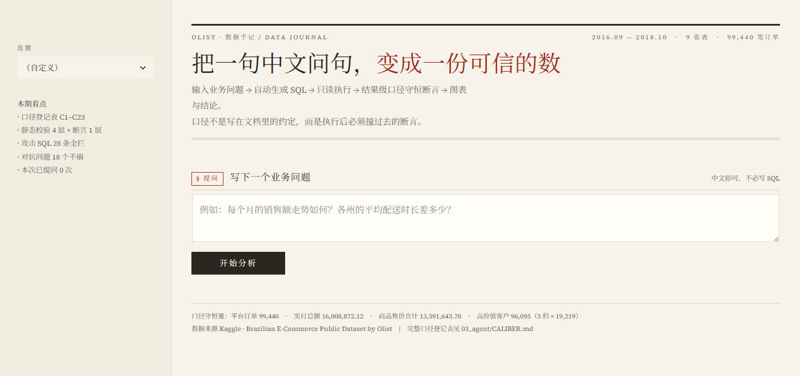
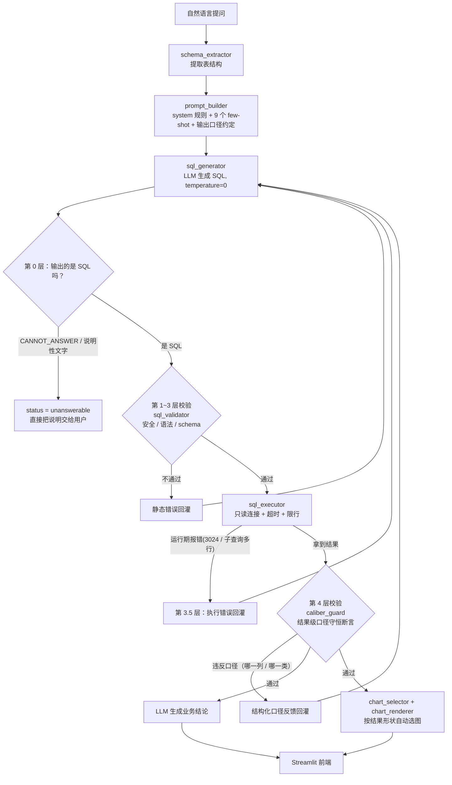
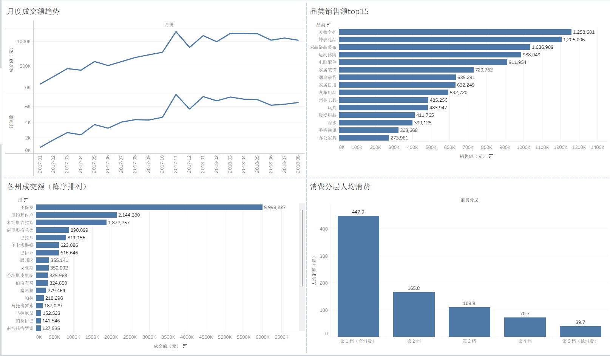
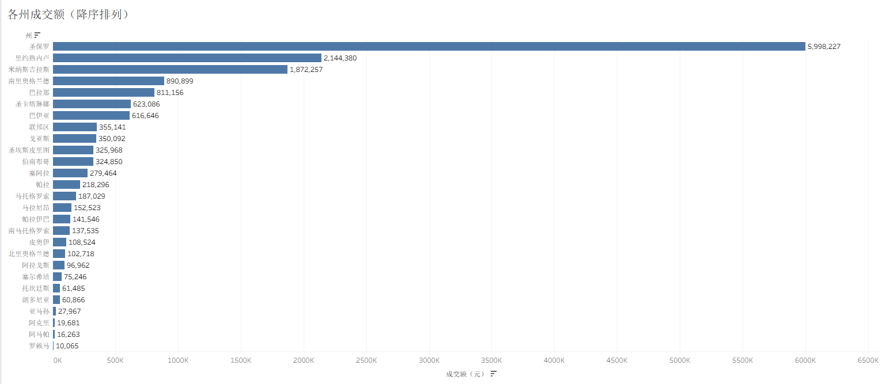
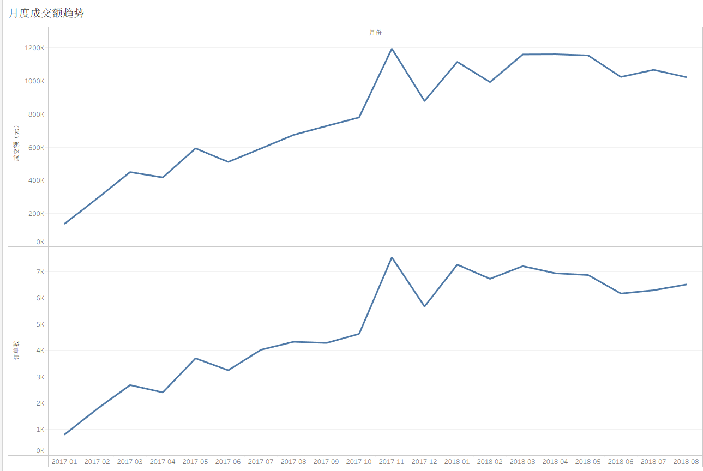
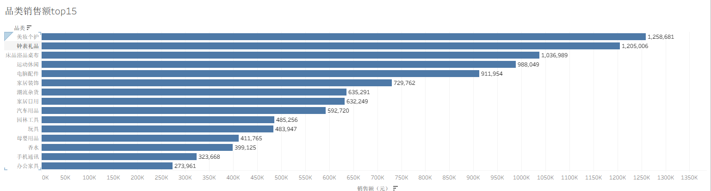
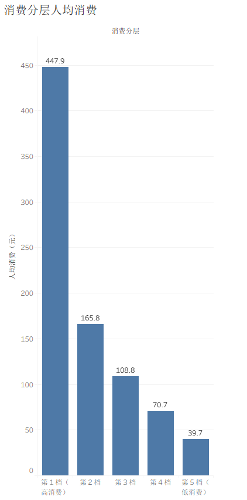
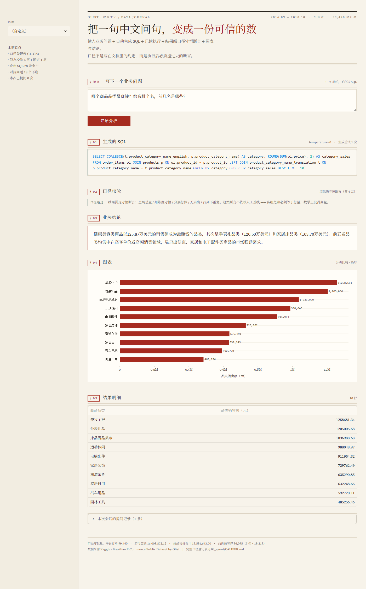

# Olist 电商数据分析 Agent（Text2SQL）


用自然语言提业务问题，Agent 生成 SQL、经四层校验后执行，输出图表与业务结论。
数据集为 Kaggle Brazilian E-Commerce（Olist，约 10 万订单），MySQL 存储，
LLM 可换任意 OpenAI 协议服务（GLM / DeepSeek / 通义千问兼容模式）。



## 特性

- 完整链路：数据入库 → 手写 SQL 基线 → Agent → 自动评估 → 可视化 → Streamlit 前端
- 四层校验：安全 / 语法 / schema 静态校验，加执行后的结果级口径断言（第 4 层）
- 口径治理：23 条指标口径登记在 `03_agent/CALIBER.md`，落地五处
  （基线 SQL / prompt / few-shot / 评估指标 / 第 4 层断言），`caliber_check.py` 一键自检
- 评估：3 模型 × 10 题、四个指标；其中口径通过率不依赖人工基线
- 分析模块：环比同比、履约漏斗、A/B 测试统计检验（见[分析模块](#分析模块)）
- BI 层：4 张预聚合宽表直连 Tableau，口径与 Agent 层共用同一登记表
- 工程：92 项单元测试（全 mock）、GitHub Actions CI、Docker Compose 一键启动

## 快速开始

环境：Python 3.8+、MySQL 5.7+（或直接用 Docker）。

```bash
pip install -r requirements.txt
cp .env.example .env        # 填入 MySQL 密码与 LLM API Key

python 01_data/import_data.py     # CSV 导入 MySQL（数据准备见下）
streamlit run 05_app/app.py       # 前端 http://localhost:8501
```

Docker：

```bash
docker compose up -d
docker compose exec app python 01_data/import_data.py   # 仅首次
```

其他入口：

```bash
python 03_agent/agent.py "每个月的销售额走势如何？"        # 命令行单问
python 03_agent/evaluate.py my-model                     # 准确率评估
python 03_agent/caliber_check.py                         # 口径自检，FAIL 时退出码 1
python 03_agent/stress_test.py                           # 防火墙压测，--e2e 追加端到端对抗
python 02_sql/run_mom_yoy.py                             # 环比 / 同比分析
python 02_sql/run_funnel.py                              # 履约漏斗
python -m unittest discover -s 03_agent/tests -t 03_agent/tests   # 92 项单测，无需 DB 与 Key
```

配置优先级：环境变量 > `.env` > `config.yaml`。切换模型不用改文件：

```bash
OPENAI_MODEL=deepseek-chat OPENAI_BASE_URL=https://api.deepseek.com python 03_agent/evaluate.py deepseek
```

### 数据准备

从 Kaggle 下载 *Brazilian E-Commerce Public Dataset by Olist*（9 个 CSV），建库导入，
表名统一为项目短名：

```sql
CREATE DATABASE olist_ecommerce CHARACTER SET utf8mb4;
```

| CSV 原始表名 | 项目表名 |
|---|---|
| olist_orders_dataset | `orders` |
| olist_order_items_dataset | `order_items` |
| olist_order_payments_dataset | `order_payments` |
| olist_customers_dataset | `customers` |
| olist_products_dataset | `products` |
| olist_sellers_dataset | `sellers` |
| olist_order_reviews_dataset | `order_reviews` |
| product_category_name_translation | `product_category_name_translation` |
| olist_geolocation_dataset | `geolocation` |

## 校验链路



| 层 | 时机 | 拦什么 |
|---|---|---|
| 0 | 模型输出后 | 模型答不了时给的自然语言说明（`CANNOT_ANSWER`），直接转交用户，不消耗重试 |
| 1–3 | 执行前 | 写操作 / 堆叠语句 / 锁子句；语法错误；不存在的表列 |
| 3.5 | 执行期异常 | `EXPLAIN` 只解析不执行，"子查询返回多行""超时 3024"这类错误只能执行期暴露 |
| 4 | 拿到结果后 | 守恒断言：各组之和 = 总量、无扇出、分层列不重复；违反时把"哪列 / 哪条口径 / 正确写法"回灌重写 |

前三层保证 SQL 能跑，第 4 层保证结果算得对：扇出、分母错这类错误语法完全合法、
`EXPLAIN` 也过，只有拿到结果集才能发现。各层共用同一份重试预算（`MAX_RETRIES=2`），
模型是改到对为止，不是跑通就交。

## 评估结果

3 模型 × 10 道业务题：

| 模型 | 可执行率 | 严格一致率 | 核心一致率 | 口径通过率 |
|------|:---:|:---:|:---:|:---:|
| GLM-4.5-Air | 100% | 60% | 100% | 100% |
| GLM-4.6V | 100% | 60% | 100% | 100% |
| DeepSeek-Chat | 100% | 70% | 100% | 100% |

四个指标各回答一个不同的问题：

| 指标 | 定义 | 需要基线 |
|---|---|:---:|
| 可执行率 | SQL 没被静态校验拦下、能跑出结果 | 否 |
| 严格一致率 | 结果取值多重集与基线完全相同（忽略列名列序） | 是 |
| 核心一致率 | 行数一致 + 该题核心指标列全部命中；辅助列可多可少 | 是 |
| 口径通过率 | 第 4 层守恒断言全部通过 | 否 |

每题的核心指标列定义在 `03_agent/evaluate.py` 的 `CORE_COLS`。
严格 / 核心一致率依赖人工基线；口径通过率只看守恒式（各组之和 = 总量、量纲关系、
扇出不变量），没有标答的真实业务里也能跑。

口径治理前后（全程未换主模型）：

| 指标 | 治理前 | 治理后 |
|---|:---:|:---:|
| 严格一致率 | 10–20% | 60–70% |
| 核心一致率 | 40–60% | 100% |
| 口径通过率 | 未度量 | 100% |

## 口径治理

口径指题面没有规定、但答案必须唯一确定的计算约定：谁进分母、用哪个函数、
先聚合谁、输出哪些列。本项目 23 条口径登记在 `03_agent/CALIBER.md`，
按五步流程变更（登记表定稿 → 改基线 → 重跑基线 → 改 prompt / few-shot / CORE_COLS → 重跑评估）。

实践中挖出的真实问题（完整记录见 `CALIBER.md`）：

- prompt 与基线互相矛盾：prompt 写 `DATEDIFF`、基线写 `TIMESTAMPDIFF`，模型被主动引向错误算法
- 通用规则误伤另一题："算时长不过滤未签收订单"套到月度趋势上导致行数变多，必须分情形规定
- 扇出风险写进 prompt 后模型照样犯——软约束不够，需要执行后的硬断言，这是第 4 层的由来

第 4 层断言：

| 断言 | 守恒式（或形状约束） | 抓到过的真实错误 |
|---|---|---|
| 全局总量守恒 | 单行结果 `total_orders = 99,440`；金额按 SQL 实际口径对照 16,008,872.12 / 13,591,643.70 | 用 `orders` 单表数订单 → 99,441 |
| 州维度守恒 | 各州订单数之和 = 99,440；各州金额之和 = 平台总额 | 41,746 ≠ 41,745；GMV 被 JOIN 放大 |
| 州输出齐全 | 按问题驱动：问分布 → 三列齐全；只问金额 → 只要求金额列 | 只给订单数，漏 GMV 与时长 |
| 分层总体守恒 | 各档客户数之和 = 96,095（5 档 × 19,219） | 总体被过滤成"已签收 / 有评价"→ 18,672 |
| 分层列不重复 | 分层结果任意两个数值列不得逐行相同 | 两个模型把人均单数写成 `SUM(total_spend)/COUNT(*)` |
| 无扇出 | `JOIN order_payments` 后求时长均值必须先 `GROUP BY order_id` | DeepSeek Q5：时长被一单多付扇出加权 |

作用域闸门（C23）：守恒式的前提是分组覆盖全集。SQL 带 `LIMIT`、取 TopN、或被 1000 行
上限截断时断言主动跳过——误报比漏报麻烦，漏报只是少抓一个错，误报会把正确结果改坏。

## 分析模块

```bash
python 02_sql/run_mom_yoy.py    # 月度 GMV 环比（LAG 窗口函数）/ 同比（自连接）
python 02_sql/run_funnel.py     # 履约漏斗：下单 → 支付 → 发货 → 送达 → 好评
```

```python
from ab_test import conversion_ztest, required_sample_size

conversion_ztest(100, 1000, 120, 1000)  # 两比例 z 检验：转化率差异是否显著（p 值）
required_sample_size(0.10, 0.02)         # 检出 2pp 提升每组所需样本量
```

真实数据上的结论示例：2017-11（巴西黑五）GMV 环比 +52%、次月回落 -26%；
履约漏斗最大流失在送达 → 好评（21.5%，评价属自愿行为，预期内流失），
支付 / 发货 / 送达各环节转化率均 >98%。

## BI 看板（Tableau）

`06_bi/make_bi_exports.py` 按口径预聚合 4 张宽表（中文列名与取值），Tableau 直连 CSV 出图。
脚本自带 12 条断言（6 守恒 + 2 完整月 + 4 形状），不通过则退出码 1。
数据字典与操作步骤见 `06_bi/README.md`。



| 工作表 | 数据源 | 核对点（与 CALIBER.md 一致） |
|---|---|---|
| 各州成交额（降序） | `dim_state.csv` | 圣保罗 5,998,227；27 州合计 = 16,008,872 |
| 月度成交额趋势 | `fct_monthly.csv` | 只画 20 个完整月（2017-01 ~ 2018-08），末月 1,022,425 |
| 品类销售额 Top 15 | `dim_category.csv` | 首名美妆个护 1,258,681；Top 15 占全网 76.29% |
| 消费分层人均消费 | `dim_customer_segment.csv` | 447.9 / 165.8 / 108.8 / 70.7 / 39.7，各档均 19,219 人 |






比值指标的一个坑：筛选后看总客单价，`AVG([客单价（元）])` 是错的（平均的平均 ≠ 总体比值），
要建计算字段 `SUM([成交额（元）]) / SUM([订单数])`。这条与 Agent 层 C2 是同一条规则——
口径治理同样约束 BI 层的手工计算字段。

## 界面与图表

结果页依次给出生成的 SQL、第 4 层口径结论、业务结论、自动选择的图表与结果明细。
口径断言不通过时显示告警并列出违反的口径，不输出结论。



图表样式集中在 `04_visualization/chart_renderer.py`；列名与取值的中文化在
`labels.py`（27 个州、71 个品类、订单状态、支付方式、消费分层）。
不启动 Streamlit 时，`python 04_visualization/make_sample_charts.py` 生成
`sample_charts.html`，可离线查看 10 题全部图表。

## 项目结构

```
.
├── 01_data/                数据导入与只读账号脚本
│   ├── import_data.py      CSV 导入 MySQL
│   └── questions.py        10 个业务问题定义
├── 02_sql/                 手写 SQL 基线（评估用 ground truth）
│   ├── sql_answers.sql     10 题基线 SQL（多表 JOIN / 窗口函数）
│   ├── mom_yoy.sql         环比 / 同比分析模板
│   └── funnel.sql          履约漏斗
├── 03_agent/               核心链路：生成 → 四层校验 → 执行 → 结论
│   ├── agent.py            编排器（失败回灌重试）
│   ├── sql_generator.py    LLM 调用，带 LRU 缓存
│   ├── sql_validator.py    第 1-3 层：安全 / 语法 / schema
│   ├── caliber_guard.py    第 4 层：结果级守恒断言
│   ├── ab_test.py          A/B 测试统计（z 检验、样本量估算）
│   ├── CALIBER.md          口径登记表（唯一真源）
│   └── tests/              92 项单元测试（全 mock，CI 约 1 秒）
├── 04_visualization/       自动选图 + Plotly 渲染 + 中文标签层
├── 05_app/                 Streamlit 前端
├── 06_bi/                  Tableau 预聚合宽表，含数据字典
├── docs/screenshots/       界面与看板截图
├── Dockerfile              容器化构建
├── docker-compose.yml      一键起 MySQL + 应用
└── config.yaml             非敏感配置；守恒量在 03_agent/caliber_config.yaml
```

## 测试与 CI

- 92 项单元测试：覆盖口径自检、第 4 层断言、安全 / 执行边界、执行期回灌、
  可视化选图与中文标签、A/B 统计；全 mock，无需数据库与 API Key，2 秒内跑完
- GitHub Actions 在 push / PR 时跑全部单测 + 口径自检
- `stress_test.py`：23 条攻击 SQL + 5 条执行器绕过用例（离线），18 个端到端对抗问题
  （破坏性意图 / 提示注入 / schema 幻觉 / 歧义 / 口径陷阱 / 鲁棒性六类）。
  历史上找出 4 个真实缺口与 2 个第 4 层误报，均已修复并固化成回归用例，
  过程见 `03_agent/STRESS_REPORT.md`

## 已知限制

- 严格一致率不是 100%：Q2 / Q3 / Q4 / Q9 的差异主要是辅助列（基线给明细列、模型只输出必需列），
  属有意接受的差异，核心指标全部命中
- 口径断言覆盖"可知"而非"全部"：主观口径（如高价值客户如何定义）无法判断；
  新题形状不同需补断言，宁可漏判也不误判
- 守恒断言对 LIMIT / TopN / 截断等部分视图主动跳过（C23），这类查询的正确性靠核心一致率兜底
- `CANNOT_ANSWER` 是显式协议：不消耗重试预算，但不保证识别所有"其实答得了"的问题
- `MAX_RETRIES=2`：连续 3 次违反同一口径时仍返回结果，如实标记 `caliber_ok=false`，不假装通过
- 守恒量来自本数据集（99,440 / 96,095 / 16,008,872.12 / 13,591,643.70），换数据集需重新取真值
- 只读账号需用 `01_data/setup_readonly_user.py` 创建（Docker 模式自动创建）；
  未创建时回退 `.env` 中的账号，代码层仅放行 SELECT
- LLM 在 `temperature=0` 下仍非完全确定，单次评估有波动，结论以整体趋势为准

## 路线图

- [x] 口径自检脚本 + 回归测试（`caliber_check.py`）
- [x] 第 4 层口径断言 + 结构化反馈回灌（`caliber_guard.py`）
- [x] 三模型同口径对比 + 四指标评估
- [x] 高压测试 + 安全 / 执行边界单测
- [x] 第 0 层拒答协议、第 3.5 层执行反馈、C23 作用域闸门
- [x] 中文标签层 + 纸面铅印风主题
- [x] 单测与口径自检接入 CI
- [x] 口径断言配置化（`caliber_config.yaml`）
- [x] 环比同比 / 履约漏斗 / A/B 测试分析模块
- [x] 连接池、只读账号、Docker 持久化与健康检查
- [ ] C20 的问题驱动目前靠中文关键词正则，改为让 LLM 先声明需要哪几列
- [ ] 多轮追问与图表交互下钻
- [ ] Streamlit Community Cloud 在线 demo

## 数据来源

Kaggle — *Brazilian E-Commerce Public Dataset by Olist*（约 10 万订单，2016-09 ~ 2018-10）。
数据版权归原作者，本项目仅用于学习与作品展示。
